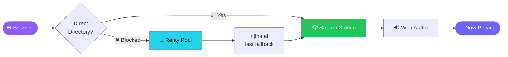

<!-- ═══════════════════════════════════════════════════════════════════════════
     HEXAIRADIO-BROWSER — Animated README
     ✦ Realtime badges  ✦ Animated effects  ✦ Mobile-friendly
     ═══════════════════════════════════════════════════════════════════════════ -->

<div align="center">

<!-- ░░ ANIMATED WAVE HEADER ░░ -->


<!-- ░░ LIVE STATUS BADGES ░░ -->
<p>
  
  
  
</p>

<!-- ░░ DEPLOY & LICENSE BADGES ░░ -->
<p>
  <a href="https://hexsleuth.github.io/HexAIRadio-BROWSER/"></a>
  
  
  
  
</p>

<!-- ░░ ANIMATED TYPING BANNER ░░ -->
<a href="https://hexsleuth.github.io/HexAIRadio-BROWSER/">
  
</a>

<!-- ░░ CTA BUTTONS ░░ -->
<p>
  <a href="https://hexsleuth.github.io/HexAIRadio-BROWSER/"></a>
  <a href="#-features"></a>
  <a href="#-station-directory"></a>
</p>

</div>

---

<!-- ═══════════════════════════════════════════════════════════════════════════ -->

<div align="center">

## ✦ What is HEXAIRADIO-BROWSER?

**A lightweight, client-side web radio player** to discover, stream, and explore live chart, AM, and FM radio stations from across the globe — routed through an unlimited, digital music service that gives you access to **millions of songs**.

*Runs directly inside any modern web browser.*
**No accounts · No downloads · No plugins · No cookies.**

</div>

<!-- ░░ DIVIDER ANIMATION ░░ -->


## ⚡ Live Feature Strip

<div align="center">

| 🎧 **Live FM & AM** | 🌍 **Worldwide** | ⚡ **Instant Tuning** | 🍪 **No Cookies** |
|:---:|:---:|:---:|:---:|
| **📱 Mobile Ready** | **🏆 Top Charts** | **⭐ Favourites** | **🎛 HEXSleuth FM** |

</div>

<p align="center">
  
  
  
</p>

---

## 🚀 Quick Start

<div align="center">

```bash
# 1 · Clone
git clone https://github.com/HexSleuth/HexAIRadio-BROWSER.git

# 2 · Enter
cd HexAIRadio-BROWSER

# 3 · Serve (any static server works)
python -m http.server 8080
#   or
npx serve .
```

Then open → http://localhost:8080
— or skip all of that and just hit the live site —

▶ hexsleuth.github.io/HexAIRadio-BROWSER

</div>

---

✨ Features

<table>
<tr>
<td width="50%" valign="top">

🎵 Player

· ▶️ Live FM / AM / Internet radio
· 🌐 Unlimited worldwide chart stations
· 🏆 Top Charts — tap any entry to instantly play
· ⭐ Favourites — save your go-to stations
· 🎛 HEXSleuth FM — 88.0 MHz built-in tuner
· 🔊 Instant tuning, zero buffering clutter

</td>
<td width="50%" valign="top">

🎨 Experience

· 🌗 Forced dark mode — consistent readability
· 🎨 33-palette theme gallery
  <sub>hexdark · synthwave · halloween · forest · aqua · dracula · cyberpunk · nord · cupcake · retro …</sub>
· 🖌 Custom colours & appearance controls
· 📱 Fully mobile-responsive interface
· ✨ Smooth animated effects throughout
· 🔄 Direct-first → relay fallback loading

</td>
</tr>
</table>

<p align="center">
  
  
  
</p>

---

🌍 Station Directory

<div align="center">

Live worldwide charts from the radio directory.
Tap any entry to instantly play that station.

</div>

<table>
<tr><th align="center">Country / Flag</th><th align="left">Station</th><th align="left">Genre</th></tr>
<tr><td align="center">🇫🇮 Finland</td><td><b>Christmas FM</b> — Non-stop!</td><td><code>advent</code></td></tr>
<tr><td align="center">🇮🇹 Italy</td><td><b>Radio Armisa</b></td><td><code>anni 80</code></td></tr>
<tr><td align="center">🇫🇷 France</td><td><b>RTL</b></td><td><code>généraliste</code></td></tr>
<tr><td align="center">🇫🇷 France</td><td><b>France Info</b></td><td><code>aac</code></td></tr>
<tr><td align="center">🇺🇸 USA</td><td><b>Classic Vinyl HD</b></td><td><code>1930</code></td></tr>
<tr><td align="center">🇫🇷 France</td><td><b>RMC Info Talk Sport</b></td><td><code>sports news</code></td></tr>
<tr><td align="center">🇫🇷 France</td><td><b>Europe 1</b></td><td><code>généraliste</code></td></tr>
<tr><td align="center">🇩🇪 Germany</td><td><b>MANGORADIO</b></td><td><code>music</code></td></tr>
<tr><td align="center">🇷🇺 Russia</td><td><b>Anon.FM</b></td><td><code>anime</code></td></tr>
<tr><td align="center">🇺🇸 USA</td><td><b>101 SMOOTH JAZZ</b></td><td><code>easy listening</code></td></tr>
<tr><td align="center">🇫🇷 France</td><td><b>France Inter</b></td><td><code>debate</code></td></tr>
<tr><td align="center">🇩🇪 Germany</td><td><b>SWR3</b></td><td><code>news</code></td></tr>
<tr><td align="center">🇺🇸 USA</td><td><b>Radio Paradise Main Mix</b> <sub>EU 320k AAC</sub></td><td><code>california</code></td></tr>
<tr><td align="center">🇩🇪 Germany</td><td><b>Deutschlandfunk</b> <sub>DLF MP3 128k</sub></td><td><code>culture</code></td></tr>
<tr><td align="center">🇫🇷 France</td><td><b>Nostalgie HQ</b></td><td><code>Radio</code></td></tr>
<tr><td align="center">🌐 Worldwide</td><td><b>Dance Wave!</b> <sub>MP3</sub></td><td><code>club · dance · electronic · house · trance</code></td></tr>
<tr><td align="center">🇫🇷 France</td><td><b>FUN Radio</b></td><td><code>dance</code></td></tr>
<tr><td align="center">🇬🇧 UK</td><td><b>Heart 80s</b></td><td><code>80s</code></td></tr>
<tr><td align="center">🇫🇷 France</td><td><b>Nrj Hits</b></td><td><code>hits</code></td></tr>
<tr><td align="center">🇩🇪 Germany</td><td><b>80s80s Radio</b></td><td><code>80s</code></td></tr>
<tr><td align="center">🇨🇳 China</td><td><b>CNR-1 中国之声</b></td><td><code>news</code></td></tr>
<tr><td align="center">🇹🇷 Türkiye</td><td><b>Virgin Radio Türkiye</b></td><td><code>pop rock</code></td></tr>
<tr><td align="center">🇪🇸 Spain</td><td><b>Cadena 100</b></td><td><code>music</code></td></tr>
<tr><td align="center">🇪🇬 Egypt</td><td><b>إذاعة القرآن الكريم من القاهرة</b></td><td><code>اسلامي</code></td></tr>
<tr><td align="center">🇮🇳 India</td><td><b>Bollywood Gaane Purane</b></td><td><code>Radio</code></td></tr>
<tr><td align="center">🇬🇧 UK</td><td><b>CAPITAL</b> <sub>The UK's No.1 Hit Music Station</sub></td><td><code>capital</code></td></tr>
<tr><td align="center">🇹🇷 Türkiye</td><td><b>Power POP</b></td><td><code>00s</code></td></tr>
<tr><td align="center">🇹🇷 Türkiye</td><td><b>Radyo 7</b></td><td><code>Radio</code></td></tr>
<tr><td align="center">🇺🇸 USA</td><td><b>Fox News Radio</b></td><td><code>news</code></td></tr>
<tr><td align="center">🇮🇹 Italy</td><td><b>Radio 24 il sole 24 ore</b></td><td><code>news talk</code></td></tr>
<tr><td align="center">🇺🇸 USA</td><td><b>WALM 2 HD</b></td><td><code>choral</code></td></tr>
<tr><td align="center">🇹🇷 Türkiye</td><td><b>DamarTurk FM</b></td><td><code>Radio</code></td></tr>
<tr><td align="center">🇫🇷 France</td><td><b>France Culture</b></td><td><code>aac</code></td></tr>
<tr><td align="center">🇨🇳 China</td><td><b>怀集音乐之声</b></td><td><code>music</code></td></tr>
<tr><td align="center">🇹🇷 Türkiye</td><td><b>90lar turkey</b></td><td><code>hits 90's</code></td></tr>
<tr><td align="center">🇺🇸 USA</td><td><b>SomaFM Groove Salad</b> <sub>128k MP3</sub></td><td><code>ambient</code></td></tr>
<tr><td align="center">🇬🇧 UK</td><td><b>BBC World Service</b></td><td><code>bbc</code></td></tr>
<tr><td align="center">🇹🇷 Türkiye</td><td><b>JOY TÜRK TURKEY</b></td><td><code>Radio</code></td></tr>
<tr><td align="center">🇫🇷 France</td><td><b>RFM</b></td><td><code>Radio</code></td></tr>
<tr><td align="center">🇺🇸 USA</td><td><b>Your Classical — Relax</b></td><td><code>classical</code></td></tr>
<tr><td align="center">🇩🇪 Germany</td><td><b>Bayern 3</b></td><td><code>pop</code></td></tr>
<tr><td align="center">🇪🇸 Spain</td><td><b>esRadio Madrid</b></td><td><code>news</code></td></tr>
<tr><td align="center">🇮🇳 India</td><td><b>Hindi Gold Radio</b></td><td><code>Radio</code></td></tr>
<tr><td align="center">🇹🇷 Türkiye</td><td><b>Süper FM</b></td><td><code>pop</code></td></tr>
<tr><td align="center">🇫🇷 France</td><td><b>EuroDance 90 radio</b></td><td><code>dancefloor</code></td></tr>
<tr><td align="center">🇳🇱 Netherlands</td><td><b>NPO Radio 1</b></td><td><code>local news</code></td></tr>
<tr><td align="center">🇮🇹 Italy</td><td><b>Radio Italia</b> <sub>Solo Musica Italiana</sub></td><td><code>italian pop</code></td></tr>
<tr><td align="center">🇮🇹 Italy</td><td><b>Rai Radio 1</b></td><td><code>news</code></td></tr>
</table>

<div align="center">
  <sub><i>…and thousands more inside the app. Browse by country, genre, or chart position — live.</i></sub>
</div>

---

🔁 Relay Proxies

Unlimited, cost-free public CORS relays.
HEXAIRADIO-BROWSER tries the directory directly first, then falls back through relays — so stations keep loading when direct requests are blocked. Click any relay to toggle. r.jina.ai is included as the last fallback.

```
┌─────────────────────────────────────────────────────────────┐
│  DIRECT DIRECTORY  ──▶  RELAY 1  ──▶  RELAY 2  ──▶  …       │
│                                          └──▶  r.jina.ai    │
└─────────────────────────────────────────────────────────────┘
```

<div align="center">
  
  
  
</div>

⚠️ Relays are third-party public services. Everything here is free and unlimited — refresh as often as you like.

---

🎛 HEXSleuth FM

<div align="center">

```
        ██╗  ██╗███████╗██╗  ██╗███████╗██╗     ███████╗██╗   ██╗████████╗██╗  ██╗
        ██║  ██║██╔════╝╚██╗██╔╝██╔════╝██║     ██╔════╝██║   ██║╚══██╔══╝██║  ██║
        ███████║█████╗   ╚███╔╝ ███████╗██║     ███████╗██║   ██║   ██║   ███████║
        ██╔══██║██╔══╝   ██╔██╗ ╚════██║██║     ╚════██║██║   ██║   ██║   ██╔══██║
        ██║  ██║███████╗██╔╝ ██╗███████║███████╗███████║╚██████╔╝   ██║   ██║  ██║
        ╚═╝  ╚═╝╚══════╝╚═╝  ╚═╝╚══════╝╚══════╝╚══════╝ ╚═════╝    ╚═╝   ╚═╝  ╚═╝
```

88.0 &nbsp;FM · MHz

▰▰▰▰▰▰▰▰▰▰▰▰▰▰▰▰▰▰▰▱▱▱▱▱▱ Ready to tune

</div>

---

🎨 Theme Gallery — 33 Palettes

<div align="center">

   
hexdark synthwave halloween forest
aqua black luxury dracula
business night coffee dim
sunset abyss acid corporate
cupcake bumblebee emerald retro
cyberpunk valentine garden pastel
fantasy wireframe cmyk autumn
lemonade winter nord caramellatte
silk ＋ Custom colours ＋ Appearance controls ＋ Forced Dark Mode

</div>

<p align="center">
  
  
</p>

🌙 Forced Dark Mode is permanently enforced across the entire interface for consistent readability.

---

🧩 How It Works



<div align="center">

Layer Technology
Markup HTML5 · semantic & accessible
Styling CSS3 · 33 themes · forced dark · responsive
Logic Vanilla JavaScript · client-side only
Audio Native HTMLAudioElement / Web Audio
Data radio-browser.info — live directory
Delivery GitHub Pages · static · zero backend
Privacy No cookies · no tracking · no accounts

</div>

---

📱 Mobile Ready

<div align="center">

Feature Desktop Tablet Mobile
Live player ✅ ✅ ✅
Theme gallery ✅ ✅ ✅
Station search ✅ ✅ ✅
Top Charts ✅ ✅ ✅
Favourites ✅ ✅ ✅
Relay toggle ✅ ✅ ✅
HEXSleuth FM tuner ✅ ✅ ✅

Responsive · touch-friendly · installable · fast

</div>

---

🛠 Tech Stack

<div align="center">

https://img.shields.io/badge/HTML5-E34F26?style=for-the-badge&logo=html5&logoColor=white
https://img.shields.io/badge/CSS3-1572B6?style=for-the-badge&logo=css3&logoColor=white
https://img.shields.io/badge/JavaScript-F7DF1E?style=for-the-badge&logo=javascript&logoColor=black
https://img.shields.io/badge/GitHub%20Pages-222222?style=for-the-badge&logo=githubpages&logoColor=white
https://img.shields.io/badge/Markdown-000000?style=for-the-badge&logo=markdown&logoColor=white
https://img.shields.io/badge/Web%20Radio-8B5CF6?style=for-the-badge&logo=radio&logoColor=white

</div>

---

📊 Repo Stats

<div align="center">


</div>

---

🗺 Roadmap

☑ Live FM / AM / Internet radio streaming
☑ 33-palette theme gallery + forced dark mode
☑ Top Charts & worldwide station directory
☑ Relay fallback proxy system
☑ Favourites & queue
☑ HEXSleuth FM (88.0 MHz)
☐ Offline PWA caching
☐ Sleep timer & alarm
☐ Audio visualizer
☐ User-imported station lists
☐ Multi-language UI

---

🤝 Contributing

<div align="center">

Contributions, issues, and feature requests are welcome!

<a href="https://github.com/HexSleuth/HexAIRadio-BROWSER/issues"></a>
<a href="https://github.com/HexSleuth/HexAIRadio-BROWSER/pulls"></a>
<a href="https://github.com/HexSleuth/HexAIRadio-BROWSER"></a>

</div>

```bash
# Fork → Branch → Commit → Push → PR
git checkout -b feature/amazing-feature
git commit -m "feat: add amazing feature"
git push origin feature/amazing-feature
```

---

📄 License

<div align="center">

Released under the MIT License.
See LICENSE for details.

</div>

---

<div align="center">

<!-- ░░ ANIMATED FOOTER WAVE ░░ -->


🎧 Version 3.0 · Built for the open web · Forced dark mode

<p>
  
  
  
</p>

▶ Listen Live ·
⭐ Star the repo ·
🐛 Report an issue

<sub>Made with 🎵 by <a href="https://github.com/HexSleuth">HexSleuth</a></sub>

<!-- ░░ VISITOR COUNTER ░░ -->


</div>
